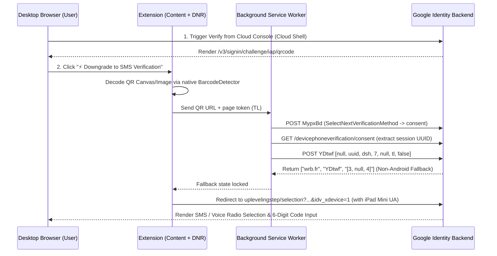

# Google QR SMS Helper (`google-qr-sms`)

<p align="center">
  
  
  
  
</p>

<p align="center">
  <b>Switch Google's mandatory cross-device QR verification (Constellation / MO-SMS) back to standard 6-digit SMS / Voice verification on desktop browsers.</b>
</p>

---

## 📖 Background

When verifying or upgrading a Google account on desktop browsers, Google increasingly enforces `/v3/signin/challenge/iap/qrcode` (`DevicePhoneVerificationUi`), requiring a mobile phone scan to trigger:
1. **Android GMS Constellation (`PhoneIdentityJsBridge.verifyPhoneNumber`)** — hardware/SIM-bound silent carrier SMS verification.
2. **Mobile-Originated SMS (MO-SMS)** — sending an outbound international SMS to Google's gateway.

If you work in an environment without an active Android GMS device or international outbound SMS capability, `google-qr-sms` automates the cross-device fallback protocol (`idv_xdevice=1` + non-Android `GetVerificationStatus` status `[3, null, 4]`) and maintains a consistent `iPad Mini` (`iPadOS`) header/navigator profile across the entire `uplevelingstep` and `batchexecute` verification lifecycle.

---

## ✨ Architecture & Workflow



### Key Technical Details
1. **Cloud Shell Entrypoint (`console.cloud.google.com`)**:
   Triggering verification from Google Cloud Console's **Cloud Shell (`[>_]`) -> `Verify`** generates a clean `uplevelingstep/selection?TL=...&authuser=0&flowName=GlifWebSignIn&sarp=1&scc=1` continuation token without nested third-party OAuth redirects.
2. **Native QR Extraction (`BarcodeDetector`)**:
   Extracts the `devicephoneverification/begin` URL directly from the DOM `` / `<canvas>` element in milliseconds without external dependencies or screenshots.
3. **Full-Path `iPad Mini` Header Consistency**:
   Uses Chrome's `declarativeNetRequest` to enforce the `iPad Mini` User-Agent (`CPU OS 16_6 like Mac OS X ... Mobile/15E148`) and strip desktop Client Hints (`Sec-CH-UA*`) across **all** `accounts.google.com/*` routes—including `/uplevelingstep/*`, `/v3/signin/challenge/*`, and the `/_/IdvUplevelingUi/data/batchexecute` RPC endpoint used when submitting the 6-digit SMS code.

---

## 🚀 Installation

### Option 1: Load Unpacked Extension
1. Clone this repository or download the latest ZIP from [Releases](https://github.com/giauphan/google-qr-sms/releases):
   ```bash
   git clone https://github.com/giauphan/google-qr-sms.git
   ```
2. Open Chrome and navigate to `chrome://extensions/`.
3. Enable **Developer mode** in the top-right corner.
4. Click **Load unpacked** in the top-left corner and select this folder (or `dist/unpacked`).

---

## 🛠️ Usage

1. **Step 1 — Open Cloud Console**:
   Log in to your Google account and visit [https://console.cloud.google.com/](https://console.cloud.google.com/).
2. **Step 2 — Trigger Cloud Shell Verification**:
   Click the **Activate Cloud Shell (`[>_]`)** icon in the top-right navigation bar (or click the extension's floating button **`1. Open Cloud Shell Terminal`**), then click **`Verify`** in the modal dialog.
3. **Step 3 — One-Click Downgrade**:
   On the QR code verification page (`/v3/signin/challenge/iap/qrcode`), click the floating button **`⚡ Downgrade to SMS Verification`** in the bottom-right corner.
4. **Step 4 — Receive 6-Digit SMS Code**:
   The page automatically transitions to the `uplevelingstep/selection` screen. Select **Verify your phone number (SMS)**, enter your phone number, and submit the 6-digit `G-xxxxxx` verification code.

---

## 📁 Project Structure (Clean Architecture)

```text
google-qr-sms/
├── src/
│   ├── domain/               # Enterprise business rules & constants
│   │   └── constants.js      # UA profiles, RPC identifiers, regex patterns
│   ├── application/          # Use cases & workflow orchestration
│   │   └── downgradeQrUseCase.js
│   ├── infrastructure/       # External services & Chrome API adapters
│   │   ├── dnrService.js     # DeclarativeNetRequest rules & client hints
│   │   └── googleIdentityClient.js # Batchexecute RPC client & token parser
│   ├── background/           # Service worker entry point
│   │   └── index.js
│   ├── content/              # Content script UI & QR detector
│   │   └── index.js
│   └── inject/               # Main-world scripts
│       └── uaSpoof.js        # Navigator profile spoof
├── scripts/
│   └── build.mjs             # Release packaging & syntax validation script
├── manifest.json             # Chrome Extension Manifest V3
├── package.json
├── LICENSE
└── README.md
```

---

## 🔨 Build

To validate all JavaScript files and package the distribution:

```bash
node scripts/build.mjs
```

Artifacts will be generated in `dist/`:
- `dist/unpacked/`: Extension folder ready for Chrome Developer Mode
- `dist/google-qr-sms-v1.0.0.zip`: Release archive ready for upload

---

## 📄 License

Released under the [MIT License](./LICENSE).
